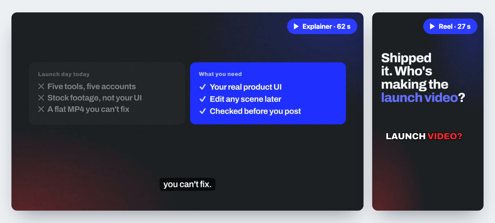
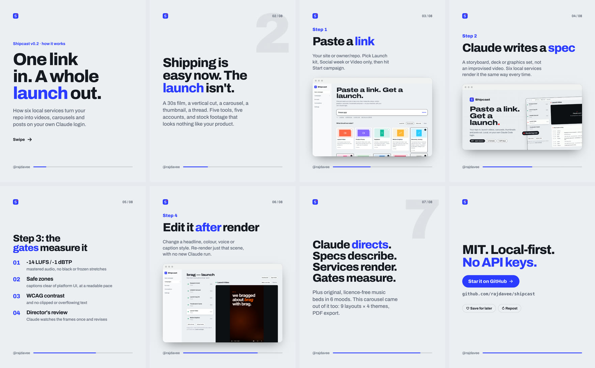
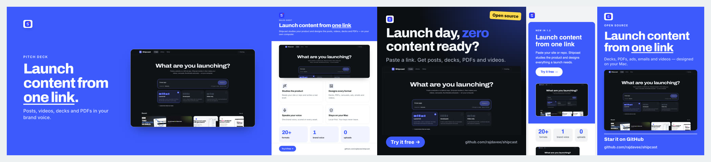
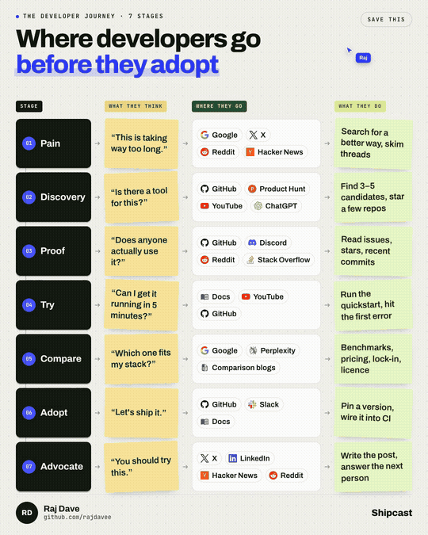
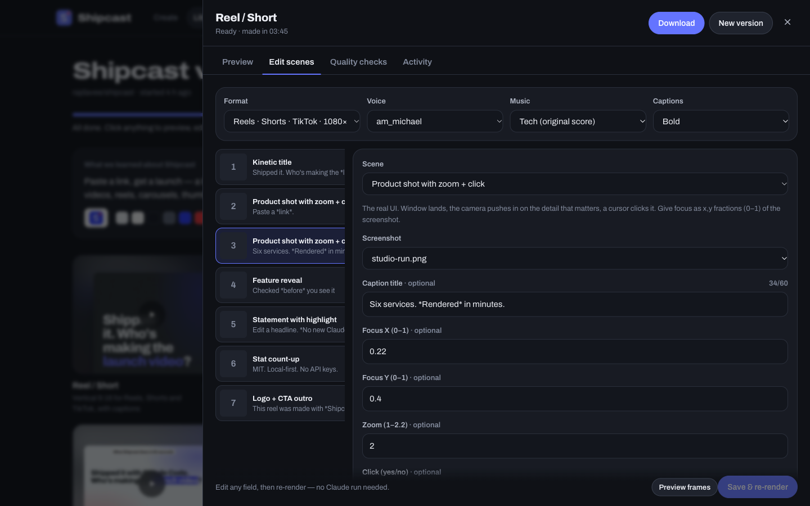
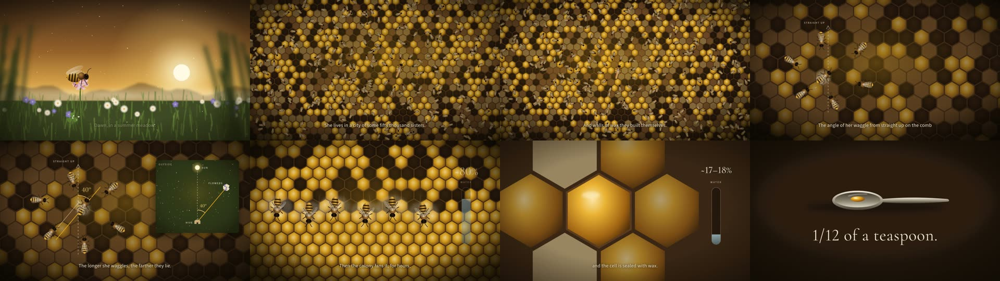
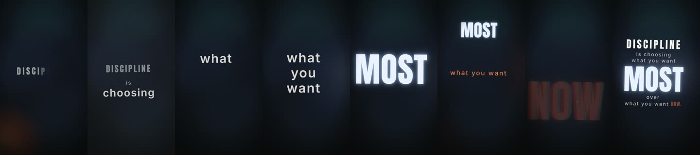
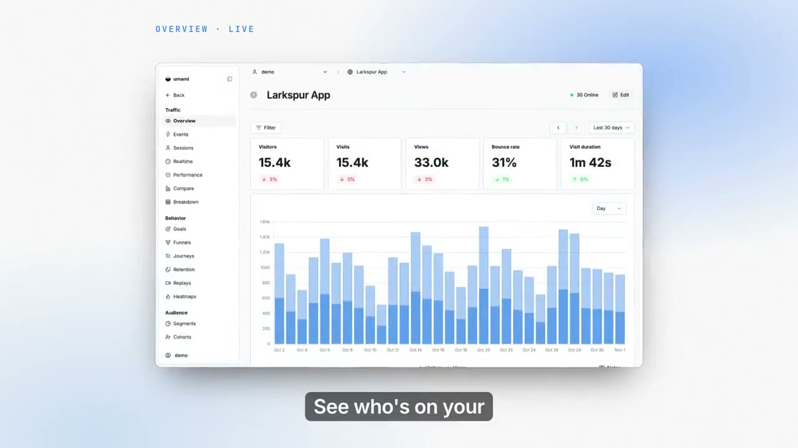
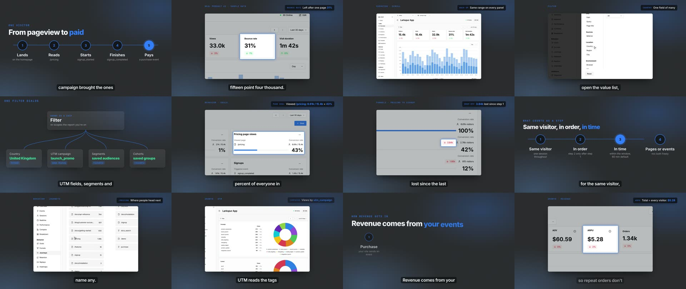
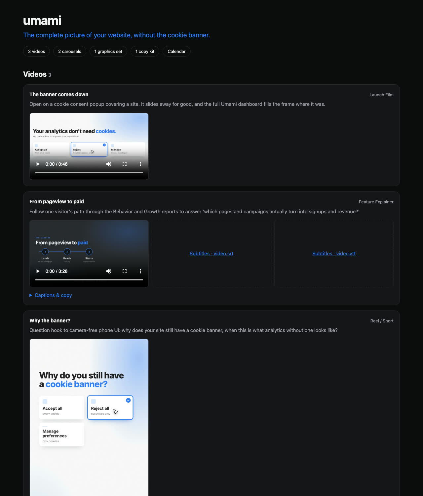

<p align="center">
  
</p>

<h1 align="center">Shipcast</h1>

<p align="center">
  <b>Paste a link. Get a launch.</b><br />
  A local-first studio that turns a website or a GitHub repo into a full campaign —<br />
  videos, reels, decks, PDFs, ads, emails, landing pages, print, carousels and posts, in your brand voice.
</p>

<p align="center">
  <a href="#quick-start">Quick start</a> ·
  <a href="#formats">Formats</a> ·
  <a href="docs/ARCHITECTURE.md">Architecture</a> ·
  <a href="docs/WRITING-PACKS.md">Write a format</a>
</p>

<p align="center">
  <a href="docs/assets/shipcast-explainer.mp4"></a><br />
  <sub>▶ <a href="docs/assets/shipcast-explainer.mp4">Explainer (62 s)</a> · <a href="docs/assets/shipcast-reel.mp4">Reel (27 s)</a> — written, scored, voiced and quality-checked by Shipcast from this repo. Banner above too.</sub>
</p>

<p align="center"></p>

<p align="center"><br />
<sub>Deck slide (with editable PPTX) · one-page PDF · ad (one of 13 sizes) · email on a phone · A3 poster with bleed — all from one brief, in one brand voice.</sub></p>

---

You built something. Now it needs a launch video, a vertical cut for Shorts, a
LinkedIn carousel, a YouTube thumbnail, an X thread, a Product Hunt blurb…
Shipcast makes all of it from one URL, on your own machine.

- **No API keys, no accounts to create.** Shipcast drives the Claude Code CLI
  you're already signed into, on your own Claude plan. GitHub access goes
  through the `gh` CLI you're already signed into.
- **Research once, make everything.** One run studies your product and writes a
  brief and brand kit — real colors, fonts, logo, screenshots, proof points,
  hooks. Every deliverable builds from it, so the set looks like one campaign.
- **Free, local media stack.** Video renders in headless Chrome + FFmpeg,
  voiceover with Kokoro, captions with whisper.cpp. Nothing is uploaded.
- **Save-worthy infographic posts.** The animated framework format that does well
  on LinkedIn: stages, what people think, where they go (with real platform
  logos), what they do. Claude researches the journey; you get a looping GIF,
  an MP4 and the post text.
- **Skill Hub — the best community skills, mixed per job.** Shipcast pulls specialist Claude skills from their own repos (pinned commits, licence-checked, installed into Shipcast only): HyperFrames and GSAP for motion, taste-skill and Anthropic's creative skills for design, diagram-design for diagrams, marketingskills and humanizer for copy, ffmpeg-skill for post-production and more. Each format asks for roles (motion, design taste, copy…) and the hub assigns the strongest enabled skill — browse and override them on the Skills page. The list lives in `skills/registry.json`.
- **Full campaign from your running app.** Point Shipcast at a repo or folder,
  add env vars, and walk away for 2–4 hours. It copies the project, sets it up
  locally (installs, a throwaway database or Docker service, seed data), fixes
  what it can, and when it truly can't — a missing licence key, a credential —
  it pauses and asks you one specific question in the app, then carries on.
  It logs in for real, films the main flows with a visible cursor, plans a
  campaign (one line, pillars, a posting calendar), makes every asset, and
  packages them in an offline hub with a zip. Secrets stay in a 600-mode file,
  are scrubbed from every output, and nothing leaves your machine.
- **Feature explainers on the real product.** Narrated "how it works" videos,
  90 s to 7 minutes: Claude reads the feature's rules in your code first,
  then the camera walks your real screens with exact highlights (element
  positions recorded at capture) and caption chips, filmed click-throughs
  auto-zoom on each click, and diagrams explain the rules — levels, worked
  examples, flows, who-does-what, a recap.
- **Product tours.** Music-led promos where the workflow plays out beat by
  beat — the messy before, forms filling, options picked, actions passing a
  checks rail — joined by motion-blurred whips.
- **Real UI, not stock filler.** Formats reuse your product's actual screens,
  components, copy and brand.
- **Revise like you'd brief a designer.** "Make the hook punchier, slow down
  scene 3" — Shipcast resumes the same session so nothing is lost.
- **Formats are folders.** Each deliverable type is a `pack.json` + `prompt.md`.
  Add one without touching code.

<p align="center"></p>

## Quick start

You need **Node 22.18+**, **FFmpeg**, and **Claude Code** signed in
(`claude auth login`). GitHub CLI is optional (private repos, PR videos).
For full campaigns from your app, Docker (colima or Docker Desktop) lets
Shipcast give apps a throwaway database.

```bash
git clone https://github.com/rajdavee/shipcast
cd shipcast
npm install
npm run build
npm start            # → http://localhost:4317
```

Then:

1. **Paste** a website, `owner/repo`, a local folder, or a few sentences about your product.
2. **Pick what to make** from the formats, or open **Full campaign from your app**
   to have Shipcast run your project, capture it and make everything (add env
   vars and a test login there if you have them).
3. **Brainstorm (optional)** — a few quick questions and three directions; sketch
   the video on the drawing board before anything renders.
4. **Watch it come together**: what Shipcast learned (colors, logo, screenshots),
   a progress strip for long runs, and each result as it's ready. If it needs a
   key or a decision, it pauses and asks you right there.
5. **Open any result** to preview, download, edit it, or type what to change
   ("punchier hook", "slower on the chart").

If something isn't connected, the **Setup** page tells you exactly what to do.

`npm run doctor` checks your machine; `npm run status` shows the services.

**Better voiceover (optional):** on the Connections page, click **Set up** next
to *Kokoro TTS*. Shipcast installs the free Kokoro voice model into its own
Python environment under `~/.shipcast/voice` — nothing is added to your system
Python — and narrated formats use it automatically. Without it, videos fall
back to your OS voice.

<p align="center">
  
</p>
<p align="center">
  
  
</p>

## Formats

**Studio formats** — Claude writes a spec, Shipcast's services render it,
quality gates measure it, and you can edit any slide or scene afterwards and
re-render without another Claude run.

| Format | What you get |
|---|---|
| **Reel / Short** | 9:16 master safe for Reels, Shorts and TikTok: 1-second hook, voiceover, word-timed captions (bold, pop, karaoke, boxed, clean, typewriter) |
| **Launch Film** | 20–40s film for YouTube, LinkedIn, X or your site: hook, the real product in motion, proof, CTA |
| **Feature Spotlight** | 8–15s silent motion graphic for the feed |
| **Explainer** | 45–75s narrated explainer — teach first, sell last |
| **Feature Explainer** | 90 s – 7 min narrated "how it works" on your real UI: part cards, walkthroughs with highlights and caption chips, filmed click-throughs, rule diagrams, recap |
| **Product Tour** | 45 s – 2 min music-led promo: the messy before, rebuilt UI that animates, real screens, a trust beat, CTA |
| **Social Posts** | Feed, portrait, wide and story images per post, with LinkedIn / Instagram / X / Facebook captions and alt text |
| **Full campaign** | Run your app → capture it → plan → every asset → an offline campaign hub, zip and a desktop notification |
| **Captions** | Upload a talking-head clip → word-timed captions (6 styles), hook title, mastered audio. No Claude turn, about a minute |
| **LinkedIn Carousel** | 6–10 slides in 4 themes × 9 layouts, upload-ready PDF, animated MP4 with music, post caption |
| **Thumbnails & Cards** | 3 YouTube thumbnails for Test & Compare, OG / GitHub cards, X & LinkedIn images, stories, banners |
| **Launch Copy Kit** | LinkedIn posts, X thread, YouTube metadata, Product Hunt, Show HN, newsletter, ads |
| **Presentation** | Pitch, sales, webinar, investor or board deck: 16 designed 16:9 layouts, PDF and an **editable PowerPoint** with speaker notes |
| **PDF document** | One-pager, sales sheet, case study, datasheet, ebook, whitepaper or report — print-ready PDF with real text, contents, running heads and charts |
| **Ad set** | One concept × 3–10 hook variants × 13 placements (Meta feed and Stories, LinkedIn, X, Google Display banners) with auto-fitting type and an upload sheet |
| **Email** | Launch email, newsletter or nurture sequence — inbox-safe HTML for Gmail and Outlook, plain text, subject and preview variants, upload zip, deliverability checks |
| **Landing page** | Responsive HTML/CSS page in your brand, each section as a snippet for any site builder, a copy deck, phone and desktop previews |
| **Print** | Posters, flyers, roll-ups and booth banners — press-ready PDFs with 3 mm bleed and crop marks, high-resolution PNGs |
| **UGC ad** | Creator-style vertical ad: a synthetic, labelled presenter delivers the hook and CTA, intercut with your real screens in the same voice |
| **Trend brief** | What your audience is paying attention to this week — signals with evidence, formats that work, hooks, ready-to-make ideas |
| **Competitor teardown** | Paste competitor ads or pages: hook, structure, offer, CTA, the gaps you can own, and original briefs that beat them |

**Freeform formats** — Claude builds directly with the open-source
[HyperFrames](https://github.com/heygen-com/hyperframes) and
[brag](https://github.com/latent-spaces/brag) skills, for ideas outside the
scene library: brag launch video, product promo, explainer, motion graphics,
Discovery Journey, changelog video from a pull request, talking-head captions.

Third-party skills are **not bundled**; Shipcast installs them from their own
repositories on first use, under their own licenses.

Videos are built from 32 motion scenes — UI walkthrough with drawn highlights, recorded click-through with auto-zoom, ladder, worked-example table, flow, tree, who-does-what matrix, checklist, a form that fills itself, an option being picked, the messy before, a checks rail, kinetic title, highlight statement, stat count-up, product zoom with cursor click (browser or phone frame), typing terminal, animated bar chart, feature reveal, testimonial, before/after, page scroll, logo sting and CTA outro — plus any of HyperFrames' ~450 registry blocks. Every video gets an **original music bed** (6 moods, cuts snapped to its beat, whooshes on transitions), a **Kokoro voiceover** aligned word-by-word to the script, and a **director's review**: after the automated checks pass, Claude looks at the rendered frames once and fixes what a human editor would.

### What "quality" means here

Every video is checked before you see it ([research](docs/research/landscape-2026.md)):
platform canvas and codec, **-14 LUFS / -1 dBTP** loudness, no black or frozen
stretches, captions inside the platform safe zone at a readable pace, no text
overlapping or clipping, WCAG contrast, a real first frame for the feed
thumbnail. Stills are audited for overflow, safe margins and minimum type size.
Copy is checked against platform limits (LinkedIn's "see more" fold, X's 280,
YouTube's 60-character titles) and a list of AI clichés. Problems go back to
Claude with the fix hint; you see what passed.

## Plan and publish

**Calendar** holds your whole content program: drag posts between days, keep a backlog of ideas, and press **Plan my month** to fill your posting slots with drafts that follow your content pillars and what's trending. Each post has its copy per channel with the platform's limits, a preview, and **Make it** — Shipcast makes the carousel, reel or document and attaches the files.

Publishing is your choice per channel: a **post kit** and a reminder (always works), **direct** LinkedIn and YouTube with your own developer app keys, or your own **Postiz** instance for Instagram, TikTok, X and more. Nothing is posted unless you schedule it, and Settings → Publishing has a pause switch. Subscribe to the calendar from Google/Apple Calendar with the ICS link.

## Learns what works for you

After a post goes out, Shipcast gets its numbers back — automatically for YouTube and anything posted through Postiz, and with a quick form, a screenshot or an export file for the rest. Each post is compared with **your own usual** on that channel at the same age, and a small local model works out what actually wins for your audience: formats, hooks, posting times, media and copy patterns. **Insights → Performance** shows it with the evidence and how sure it is; drafts get a forecast; and everything Shipcast plans and writes next leans on it — while a share of posts deliberately try something new so it keeps learning.

## Gets better on its own

Shipcast runs a few background agents while you're not using it (Setup → Background agents). They wait until your own campaigns finish, stay out of quiet hours and use a small daily share of your Claude runs.

- **Learning** — reads its own quality checks, the creative director's notes, brand-voice slips, eval scores and the changes you ask for, and turns problems that keep coming back into short lessons for that format ("Carousel: keep every text element ≥ 28 px"). Each lesson is on trial and is kept only if the problem gets rarer. See and switch them off on the **Learning** page.
- **Trending** — watches Hacker News, Reddit's marketing communities, Google Trends and YouTube, then checks what marketers report is working this month. Every card has its sources and a *Make one like this* button that opens a new campaign with the format and a recipe filled in.
- **Nightly quality check** (opt-in) — re-makes two sample pieces per night from your latest product and scores them, so a drop in quality shows up the next morning.

While it makes each piece, a critic looks at the result at real size and the weakest fixable thing is fixed before you see it.

## Brand voice

Every format writes in one voice. Paste a few paragraphs you're proud of (or
links to your site) and Shipcast hears the voice: sliders for formal ↔ casual,
serious ↔ playful, reserved ↔ bold, technical ↔ simple and humour; reading
level; who speaks; words to never use and words to always use; claims you can
back and claims you never make; emoji, hashtag and CTA policy; per-channel
overrides (LinkedIn more formal, TikTok more casual). Every finished asset is
scored against it — banned words, unsupported numbers and superlatives,
placeholders, reading level — and hard misses are rewritten before you see
them. *Check any copy* scores anything you paste and rewrites it in the voice.

## Realistic people and products

The `gen` service routes generated images and video to the right model for the
shot — photoreal stills, product-in-hand edits, image-to-video with the first
and last frame pinned, talking presenters from a portrait and a voice,
lip-sync, upscaling, background removal — across open-weights models (FLUX.2
klein, Qwen-Image, Wan 2.2, LTX, InfiniteTalk, SeedVR2, BiRefNet) and premium
hosted ones (FLUX.2 Pro, Kling 3, Seedance 2), all through your own fal.ai or
Replicate key. Packs describe **shots** (subject, motion, scene, framing,
lens, light, look), not prompts. Before anything is spent it estimates the
cost and enforces your caps (per project and per month, in Setup); identical
retakes come from cache for free. It refuses sexual content, public figures
and real people's likeness without recorded consent, and labels every
synthetic person as AI-generated. With no key connected it draws labelled
placeholders, so whole pipelines can be reviewed before paying for anything.

## Anything — any kind of video

Not every video is a product launch. Paste a brief for anything — a story, a
documentary, a music or lyric video, a tutorial, a trailer, a motivational
reel — and Shipcast reads it as content, writes a production brief (genre,
beats with timings, look, sound, original characters, sources for facts) and a
director picks the engine for each shot: original rigged cartoon characters and
illustrated worlds, motion graphics and kinetic type, charts and maps, live
captures, your uploads — plus real footage (Pixabay, Unsplash or Pexels), generated shots (fal.ai or
Replicate) and CC0 sound effects (Freesound) when you connect your own keys.

<p align="center">
  <a href="docs/assets/anything-documentary.mp4"></a><br />
  <sub>▶ <a href="docs/assets/anything-documentary.mp4">Documentary (40 s)</a> from one paragraph — facts researched and cited, illustrated, narrated, scored.</sub>
</p>
<p align="center">
  <br />
  <sub>A 9:16 kinetic-type reel from one line of text.</sub>
</p>

Original characters only (a famous character becomes an original one in the
same spirit), no real people's likeness, no sexual or explicit content.

## A real run: Umami, from repo to campaign

We pointed Shipcast at [`umami-software/umami`](https://github.com/umami-software/umami)
(MIT) from the Home page — *Full campaign from your app*, size Focused, no env
vars — and left it. It cloned the repo, ran Next.js 16 with a throwaway
PostgreSQL in Docker (pinning the repo's pnpm without touching the system),
seeded 90 days of fictional traffic for two sites, kept a small script sending
live visits so Realtime has something to show, logged in, and captured 67
screens and filmed flows with exact element positions. Then it planned the
campaign — *"The complete picture of your website, without the cookie banner"* —
made seven assets, packaged them in an offline hub, and stopped the database it
started.

<p align="center">
  <a href="docs/assets/umami-launch.mp4"></a><br />
  <sub>▶ <a href="docs/assets/umami-launch.mp4">Launch film (46 s)</a> — real UI, a filmed realtime flow that zooms on each click, captions, an original score.</sub>
</p>
<p align="center">
  <br />
  <sub>Frames from the 3½-minute <b>Feature Explainer</b> ("From pageview to paid"): every rule checked in Umami's code first.</sub>
</p>
<p align="center">
  <br />
  <sub>The campaign hub — one folder that plays offline, plus a zip.</sub>
</p>

## How it works

```
web ─► api :4317 ──► ~/.shipcast ◄── worker (Claude, your login)
                                        │ specs
            render :4320 · stills :4321 · media :4322 · qa :4323
```

Six small services, one shared data folder, no database. `shipcast start`
supervises them all; `docker compose up` puts each in its own container; any
service can move to another machine with `SHIPCAST_<NAME>_URL`. Details in
[docs/ARCHITECTURE.md](docs/ARCHITECTURE.md).

## Usage limits

Each deliverable is one Claude Code session; steps run one at a time.
Copy and carousels are light. HyperFrames videos are heavier — they build frames
with helper agents. In **Settings** you can choose the model, turn helper agents
off, and cap minutes per deliverable.

## Safety

Claude runs with file and shell tools inside the campaign folder so it can
render. Website and repo content is treated as data, never instructions; the
api listens on `127.0.0.1` only and rejects cross-site requests; generated HTML
is served in a sandbox. Run Shipcast on a machine you're comfortable letting an
agent build files on. See [SECURITY.md](SECURITY.md).

Full campaigns run your project on a **copy** (the original folder is never
changed), with sample data only. Env values live in the campaign's
`secrets.env` (mode 600), are passed to Claude's shell, never shown again in
the UI, and are scrubbed from every output file. Claude stops at any
confirmation that would send, delete or pay for real, and the hub step stops
the processes it started. Before anything runs, the project is scanned for
known malicious loaders and install hooks; a hit pauses the run until you type
RUN.

## Development

```bash
npm run dev          # api + worker on :4317, Vite with hot reload on :5173
npm test             # engine + api tests (uses a fake claude CLI)
npm run typecheck
```

The backend is TypeScript run directly by Node (type stripping) — no build
step, no runtime dependencies.

## License

[MIT](LICENSE) © rajdavee
