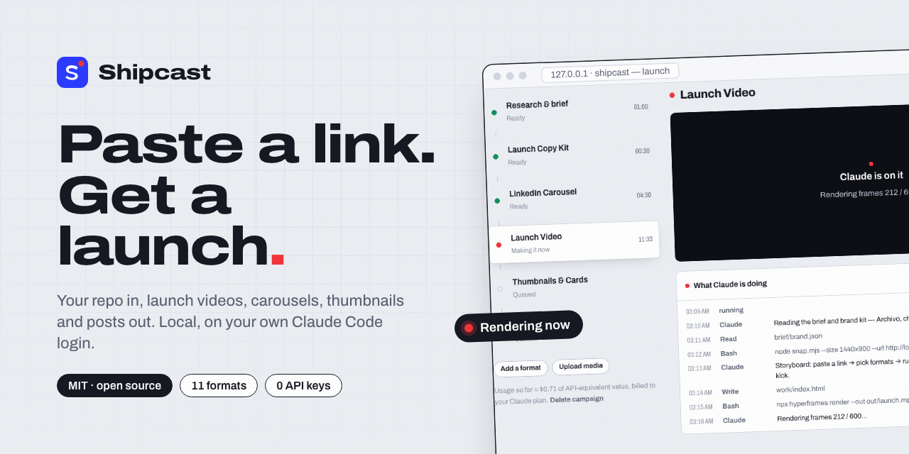
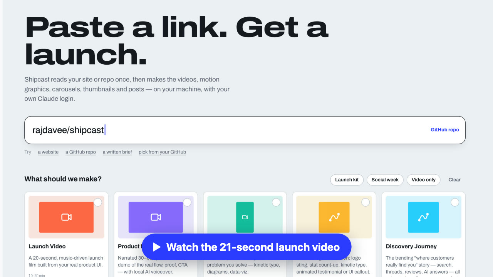
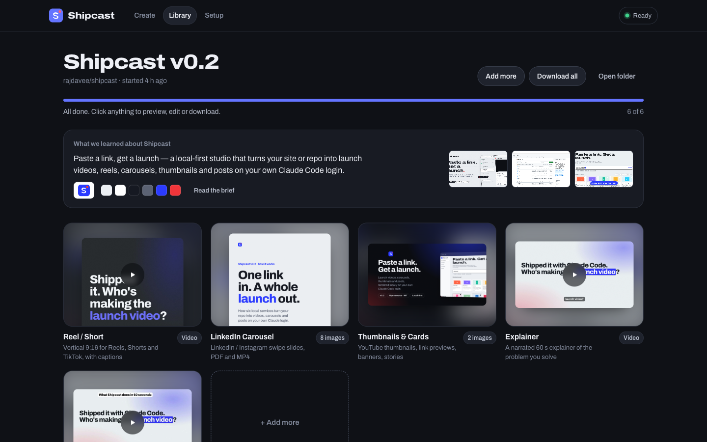
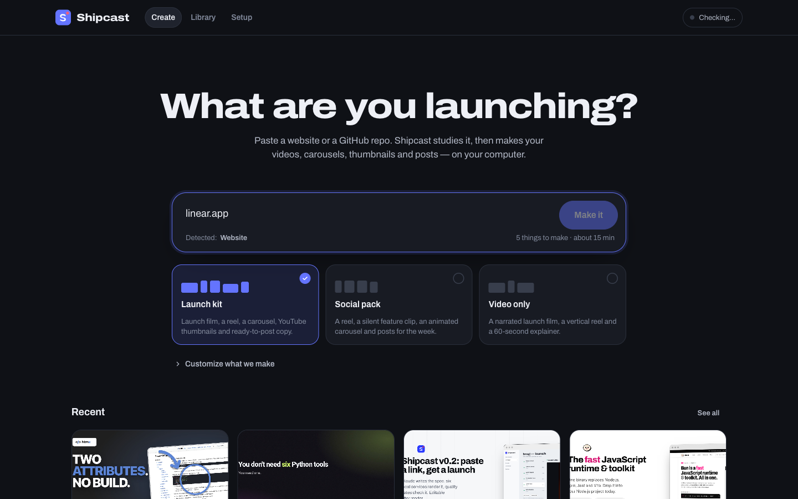

<p align="center">
  
</p>

<h1 align="center">Shipcast</h1>

<p align="center">
  <b>Paste a link. Get a launch.</b><br />
  A local-first studio that turns a website or a GitHub repo into a full campaign —<br />
  launch videos, motion graphics, reels, carousels, thumbnails and posts.
</p>

<p align="center">
  <a href="#quick-start">Quick start</a> ·
  <a href="#formats">Formats</a> ·
  <a href="docs/ARCHITECTURE.md">Architecture</a> ·
  <a href="docs/WRITING-PACKS.md">Write a format</a>
</p>

<p align="center">
  <a href="docs/assets/shipcast-launch.mp4"></a><br />
  <sub>▶ The launch video above (and the banner, and <a href="docs/assets/shipcast-promo.mp4">this narrated promo</a>) were made by Shipcast, from this repo, in one campaign.</sub>
</p>

<p align="center"></p>

---

You built something. Now it needs a launch video, a vertical cut for Shorts, a
LinkedIn carousel, a YouTube thumbnail, an X thread, a Product Hunt blurb…
Shipcast makes all of it from one URL, on your own machine.

- **No API keys, no accounts to create.** Shipcast drives the Claude Code CLI
  you're already signed into, on your own Claude plan. GitHub access goes
  through the `gh` CLI you're already signed into.
- **Research once, make everything.** One run studies your product and writes a
  brief and brand kit — real colors, fonts, logo, screenshots, proof points,
  hooks. Every deliverable builds from it, so the set looks like one campaign.
- **Free, local media stack.** Video renders in headless Chrome + FFmpeg,
  voiceover with Kokoro, captions with whisper.cpp. Nothing is uploaded.
- **Real UI, not stock filler.** Formats reuse your product's actual screens,
  components, copy and brand.
- **Revise like you'd brief a designer.** "Make the hook punchier, slow down
  scene 3" — Shipcast resumes the same session so nothing is lost.
- **Formats are folders.** Each deliverable type is a `pack.json` + `prompt.md`.
  Add one without touching code.

## Quick start

You need **Node 22.18+**, **FFmpeg**, and **Claude Code** signed in
(`claude auth login`). GitHub CLI is optional (private repos, PR videos).

```bash
git clone https://github.com/rajdavee/shipcast
cd shipcast
npm install
npm run build
npm start            # → http://localhost:4317
```

Then:

1. **Connections** — confirm Claude is connected (or click *Sign in with
   Claude*), optionally connect GitHub. The page also checks FFmpeg, Chrome,
   voice and captions.
2. **New campaign** — paste `yourproduct.com`, `owner/repo`, a folder path, or
   a paragraph describing the product.
3. Pick formats (or a bundle like *Launch kit*), tweak options, start.
4. Watch the run sheet: research first, then each deliverable, with a live feed
   of what Claude is doing. Play, preview, copy, download, or ask for changes.

`npm run doctor` checks your machine from the terminal.

**Better voiceover (optional):** on the Connections page, click **Set up** next
to *Kokoro TTS*. Shipcast installs the free Kokoro voice model into its own
Python environment under `~/.shipcast/voice` — nothing is added to your system
Python — and narrated formats use it automatically. Without it, videos fall
back to your OS voice.

<p align="center"></p>

## Formats

| Format | What you get | Built on |
|---|---|---|
| **Launch Video** | 20s music-driven launch film from your real UI, poster, share copy | [`brag-slim`](https://github.com/latent-spaces/brag) |
| **Product Promo** | Narrated 15–60s promo with local AI voiceover and captions | [HyperFrames](https://github.com/heygen-com/hyperframes) `product-launch-video` |
| **Explainer** | Faceless explainer of the problem you solve — kinetic type, diagrams | HyperFrames `faceless-explainer` |
| **Motion Graphics** | Logo sting, stat count-up, kinetic type, animated testimonial, UI callout | HyperFrames `motion-graphics` |
| **Discovery Journey** | The "where customers actually find you" story — feed, review, thread, search, AI answer — ending on your product | HyperFrames `general-video` |
| **Reel / Short** | 9:16 with a 1-second hook, fast cuts, word-by-word captions | HyperFrames `faceless-explainer` |
| **Changelog / PR Video** | A merged pull request turned into a feature-reveal video | HyperFrames `pr-to-video` |
| **LinkedIn Carousel** | Editorial slides as PNGs + upload-ready PDF + animated MP4 + caption | Shipcast `carousel` |
| **Thumbnails & Cards** | YouTube A/B thumbnails, OG card, X/LinkedIn images, story, GitHub banner | Shipcast `thumbnails` |
| **Launch Copy Kit** | LinkedIn posts, X thread, YouTube metadata, Product Hunt, Show HN, newsletter, ads | Shipcast `social-copy` |
| **Talking-Head Captions** | Styled, word-timed captions burned into your own clip | HyperFrames `embedded-captions` |

Third-party skills are **not bundled**. The first time a format needs one,
Shipcast installs it from its own repository with the
[`skills`](https://github.com/vercel-labs/skills) CLI, under that project's own
license. Shipcast's own skills live in [`plugin/`](plugin/) and load per run.

## How it works

```
 web (React)  ──HTTP/SSE──►  api (node:http)  ──►  ~/.shipcast/campaigns/<id>/  ◄──  worker
                                                    campaign.json, events.ndjson       │
                                                    brief/  deliverables/  uploads/    ▼
                                                                                claude -p … (your login)
```

Three small services share one folder — no database, no queue server, no
framework on the backend. Kill any of them and nothing is lost. Run the worker
separately with `npm start -- --no-worker` + `npm run worker`, or point several
workers at the same data dir. Details in [docs/ARCHITECTURE.md](docs/ARCHITECTURE.md).

## Usage limits

Each deliverable is one Claude Code session; steps run one at a time.
Copy and carousels are light. HyperFrames videos are heavier — they build frames
with helper agents. In **Settings** you can choose the model, turn helper agents
off, and cap minutes per deliverable.

## Safety

Claude runs with file and shell tools inside the campaign folder so it can
render. Website and repo content is treated as data, never instructions; the
api listens on `127.0.0.1` only and rejects cross-site requests; generated HTML
is served in a sandbox. Run Shipcast on a machine you're comfortable letting an
agent build files on. See [SECURITY.md](SECURITY.md).

## Development

```bash
npm run dev          # api + worker on :4317, Vite with hot reload on :5173
npm test             # engine + api tests (uses a fake claude CLI)
npm run typecheck
```

The backend is TypeScript run directly by Node (type stripping) — no build
step, no runtime dependencies.

## License

[MIT](LICENSE) © rajdavee
